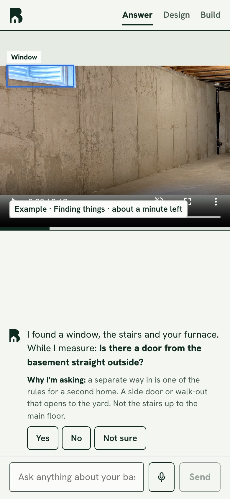
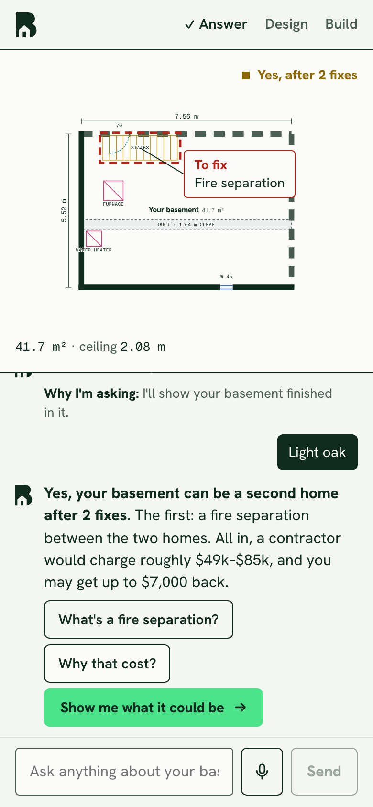
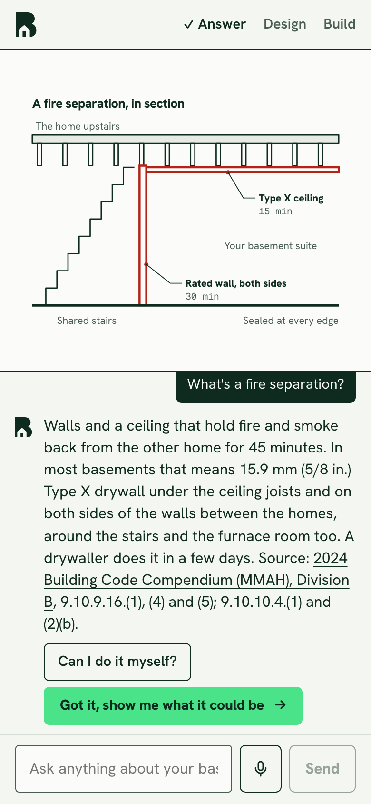
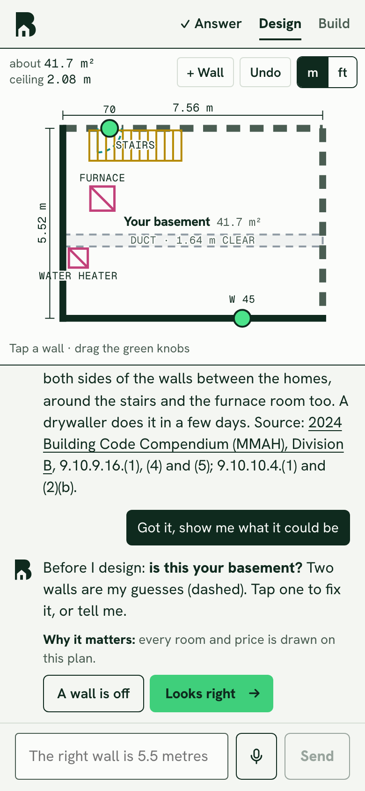
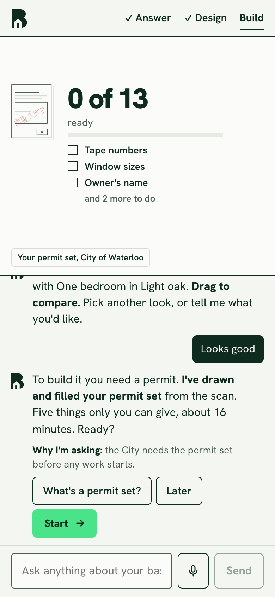
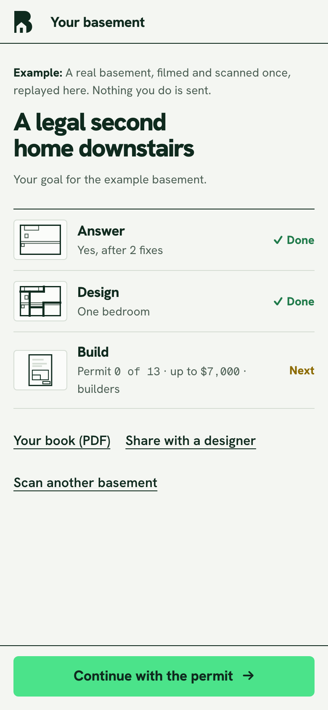

# Basement Ready

Film your basement on your phone and find out whether it can become a legal second home (an additional residential unit) anywhere in Ontario. Then a guide takes you the rest of the way, one thing at a time: the answer with proof from your own video, a layout and the look of it, then the permit set, the money and who builds it. It does the work and asks only what it can't know.

Everything here was built during the Meta AI Developer Hackathon. The first commit is Oct 28, 2026.

- **Live:** https://www.basementready.com
- **Example basement:** https://www.basementready.com/scans/sample (no account, no keys, nothing sent)
- **Demo video (3 min):** _link coming_ <!-- TODO: add the demo video link -->

<p>
  
  
  
  
  
  
</p>

_The example basement, at phone size._

## Who it's for, and why it matters

A homeowner wondering "could the basement be a home for Mom?" or "could a rental help with the mortgage?"

- **The opening is real.** Ontario's Planning Act (s. 35.1) stops zoning from banning up to three homes in a house on a serviced lot, and a second unit in an existing house pays no municipal development charges. Every basement that becomes a home is a home that needed no new land.
- **The first answer is the hard part.** The rules (ceiling height under ducts and beams, a window you can climb out of, fire separation, linked alarms, a way out) are spread across the Building Code, the Fire Code and city by-laws. Money programs are scattered, and some never launched. A Toronto price guide puts permit drawings alone at $2,000–$5,000, before anyone knows whether the basement can work.
- **What Basement Ready gives back:**
  - **Time:** film for a few minutes, and the answer comes back in about two minutes for a two-minute video.
  - **Money:** it finds the programs that fit the household, such as the federal multigenerational tax credit (up to $7,000) and, in Waterloo Region, city grants (up to $20,000 in Waterloo, $10,000 in Cambridge) and the Region's forgivable loan (up to $25,000). Each comes with its source, its conditions and how to apply.
  - **Cost:** a rough range for the whole job, hired out or partly done yourself. For the example basement, that's roughly $49k–$85k hired out.
  - **Next steps:** a draft permit set, filled-in forms, and quote requests to registered designers and trades the homeowner picks from public registries.

It screens; it doesn't decide. The municipality decides, and a designer confirms the details.

## A 3-minute path for judges

1. Open https://www.basementready.com and tap **Try the example**. It's a real unfinished basement, filmed on a phone and scanned once. Nothing you do is sent.
2. **While it measures** the guide shows the video with what SAM finds, and asks one question at a time, each with why it's asking: a door straight outside, a bathroom rough-in, the look you like. Answer anything, or "Not sure". The top bar shows the three milestones: **Answer · Design · Build**.
3. **The answer comes first:** yes, yes after fixes, or not as it is, with the fix marked on the measured plan, the rough cost and the money. Tap **What's a fire separation?** for a drawing with the rule's source, or type a question in the ask bar (the example answers from its glossary; on your own basement, Muse Spark answers anything).
4. **Design:** "Is this your basement?" on the plan itself (tap a wall, drag a knob, or say "the right wall is 5.5 metres"). Then two layouts that keep the stairs, furnace and window where they are, with one recommended and why, and your own frames before and after in the look you picked, labelled "Virtually staged".
5. **Build:** the permit set, drawn and filled from the scan, with how much is ready. The guide asks only what it can't know (a few tape numbers, the window's size, the owners, the bedrooms upstairs, a look over the sheets), then the money to apply for and who builds it. It ends at **Download the submit copy** and the book (PDF).
6. **The home base** (https://www.basementready.com/scans/sample, once you've had the answer): the goal, each milestone and where it stands, **Your book (PDF)**, **Share with a designer**, and **Continue**.

## The Meta models

Every model the app calls at runtime is Meta's. The hosted ones go through the [Meta Model API](https://dev.meta.ai/); MapAnything and DINOv2 run on our own 3D service.

| Model | What it does here | What we built on top | Code |
|---|---|---|---|
| **SAM 3.1** (`sam-3.1`) | Finds and tracks windows, doors, stairs, ducts and beams through the whole video, reads each photo of a photo take, and gives live finds while filming. It also checks every picture Muse Image makes. | Wording tuned per medium ("metal duct" in video, "ceiling duct" in photos). A track counts only if SAM holds it for half a second, and a beam must be long and level. Boxes are lifted into 3D with MapAnything's depth, so each window and door lands on the plan with a measured size. The proof frames Spark reads come from SAM's boxes. | `server/meta.ts`, `server/pipeline.ts`, `server/videoFinds.ts`, `server/photoFinds.ts`, `server/live.ts`, `server/lift.ts` |
| **Muse Spark 1.3** (`muse-spark-1.3`) | Reads SAM's finds, the proof frames, what the homeowner said and the rules, and says which rules pass, which need a fix and what to ask. It points at the furnace, water heater, panel, rough-in or bulkhead for SAM to outline, and reviews the drawn plan over the video's frames. In the guide it answers questions typed about your own basement, and turns a change in your words ("make the bedroom bigger") into edits to the design. | The trust rule, in code: no proof in the video, no claim. Code does the maths, groups the fixes and prices them. Every guide reply is checked in code before it's said: it never promises eligibility or an approval, uses only dollar figures the facts hold, and cites sources only from the rules pack. Design edits are validated against the design before they're shown. | `server/assess.ts`, `server/pointFinds.ts`, `server/floorplan.ts`, `server/guide/ask.ts`, `server/model/describe.ts` |
| **Muse Wonder 1.0** (`muse-wonder-1.0`) | Watches the whole take once, with its sound: the rooms in the order they were filmed, which were only seen through a doorway, how they join, ceilings, low ducts and beams, windows, and what the homeowner said about each room. Before "Is this your basement?", it compares the plan with the take. | Its rooms name the 3D areas and decide how they connect on the plan. Each place where the plan and the take disagree becomes one plain yes-or-no question. It describes and never measures. Wonder is in preview, so Spark watches instead if it fails. | `server/watch.ts`, `server/watchScan.ts`, `server/planCheck.ts` |
| **Muse Image 1.0** (`muse-image-1.0`) | Restyles the homeowner's own frames into the "after" of the before and after: their design, in the look they picked. | Each picture starts from a render of the 3D design over the real frame, from the camera's real position in the video, so the same pieces show from every angle. Every picture is labelled "Virtually staged". | `server/concepts.ts`, `server/views/photoreal.ts` |
| **Muse Voice Transcribe 1.0** (`muse-voice-transcribe-1.0`) | Turns what the homeowner says while filming ("this could be Mom's room") into text with timings, and what they say into the guide's microphone into their question. | The words from the take go to Spark with the finds, so what the homeowner wants shapes the answer. A spoken question lands in the ask bar to check before it's sent. | `server/pipeline.ts`, `server/meta.ts`, `src/guide/AskBar.tsx` |
| **MapAnything** ([`facebook/map-anything-apache`](https://huggingface.co/facebook/map-anything-apache), open weights) | Camera position and metric depth for every frame of an ordinary phone video. No LiDAR needed. | A 3D service around it: picking sharp frames, fitting floor, ceiling and walls, measuring each area and joining them into one basement, the floor plan with rooms, doors and fixtures, a check of each wall against the depth, and the as-built model painted with the video. One tape number rescales everything. | `services/scan3d`, `server/scan3d.ts`, `server/basement.ts`, `server/floorplan.ts`, `server/asBuilt.ts` |
| **DINOv2** (Meta, open weights) | MapAnything's image encoder. | Pinned at a fixed commit and baked into the 3D service's image. | `services/scan3d/app.py` |

### How the models check each other

- **SAM checks Muse Image.** A picture is kept only when SAM finds every window, stair and door where the real frame has them, nothing added, and every door the design drew. A design picture that fails gets one retry, told what went wrong; after that the 3D render itself is shown, labelled as a render.
- **SAM checks Spark.** Spark may only claim what a SAM find shows in a proof frame, and that's enforced in code (`server/assess.ts`). Anything unproven becomes a question for the homeowner or a detail the designer confirms.
- **Wonder checks the plan.** Before the homeowner sees "Is this your basement?", Wonder compares the plan with the whole take and raises a room that's missing, two rooms drawn as one, or a window in the wrong room.
- **A Meta model points, SAM outlines.** SAM can't find a furnace, a bulkhead or a plumbing rough-in by name. Wonder's watch says when each was filmed, Spark points at it on that frame, and SAM outlines it and tracks it through the whole video from that point (`server/pointFinds.ts`). An unsure outline, or one over most of the picture, is dropped.
- **MapAnything measures.** Every size, ceiling height and window opening comes from MapAnything's depth. The language models describe; whether a ceiling is high enough or a window big enough is decided in code from the measured numbers.

### What isn't a model call

- **The guide's script** decides what it says and asks next, the same way every time (`server/guide/script.ts`). Words like "fire separation" are answered from a glossary with the pack's sources (`server/guide/glossary.ts`). Only free-text questions and changes on your own basement go to Muse Spark. The example's guide never calls a model.
- **Rules, money and steps** are written rules packs with sources (`data/rules`), checked in code (`server/triage.ts`, `server/eligibility.ts`, `server/steps.ts`).
- **Layouts, prices and the permit set** are worked out in code from the measured plan (`server/model`, `server/quote`, `server/permit`). What the Build still needs, in order, is a list in code (`server/guide/build.ts`).
- **The filming guide's voice** is 82 short MP3 clips in `public/voice`, recorded once before shipping with open-source text-to-speech ([Chatterbox](https://github.com/resemble-ai/chatterbox), MIT, with a reference voice made with [Kokoro-82M](https://huggingface.co/hexgrad/Kokoro-82M), Apache-2.0). The scripts are in `tools/voice`. The app never calls a voice model.
- **The iPhone app** sends ARKit's camera path with the video. ARKit is Apple's tracking, not a model call.
- **Brand concept boards** in `brand/explorations` were made with an image model while designing the look. The app doesn't use them.

## How it works

```
Film it (iPhone app or browser), upload a video, or add 5–20 photos
   │
   ├── SAM 3.1 ............... windows, doors, stairs, ducts and beams, tracked through the video
   ├── Muse Wonder ........... the whole take with sound: rooms, doorways, what you said
   ├── Muse Voice Transcribe . what you said, as text
   └── MapAnything + DINOv2 .. camera path and depth: the measured 3D
         │
   Your basement's home base ──▶ the guide: Answer · Design · Build
         │
   Answer   questions while it measures, one at a time ──▶ the answer first: verdict, the fix on the plan,
            rough cost, money (rules in code + Muse Spark, with proof from SAM)
         │
   Design   "Is this your basement?" (Wonder checks the plan against the take) ──▶ two layouts, one
            recommended ──▶ before and after in your look (Muse Image, checked by SAM)
         │
   Build    the permit set drawn and filled, asking only what it can't know ──▶ the money to apply for
            ──▶ who builds it ──▶ the submit copy and the book
```

## Your scan is private

- Only the device that filmed a basement (a key kept in that browser) or your account, if you sign in, can open its guide and change anything. Anyone you send a link to sees the answer and changes nothing.
- Your names, phone and email go only on the forms and emails you send yourself. The drawings you share with a designer carry no contact details.
- Raw videos are deleted 30 days after upload. The frames, the 3D and the answer stay, so the plan still opens.
- Nothing is sent for you: quote requests, grant emails and permit forms are drafted for you to check, sign and send. The example and the demo house never send anything.

## Run it yourself

You need Node 22 or newer, pnpm 10 and ffmpeg (with ffprobe) on your PATH. The steps below were checked on macOS: from a fresh clone on Oct 30, 2026, and the example's guide again on Oct 31.

### 1. No keys: the example basement

```bash
git clone https://github.com/Dbar2/basement-ready.git
```

```bash
cd basement-ready
```

```bash
pnpm install
```

```bash
cp .env.example .env
```

```bash
pnpm dev
```

Open http://localhost:5173 and tap **Try the example** (or go straight to http://localhost:5173/scans/sample). It opens the guide while the example measures.

- The `.env` file has to exist, even with nothing filled in: the API reads it at start.
- The example is a real scan recorded once and committed under `public/samples`: its frames, SAM's finds, the 3D, the plan and the pictures. The app replays it and its guide is scripted, so the whole flow runs with no Meta key and no GPU, and makes no paid calls.
- pnpm may warn that it ignored a build script for `@clerk/shared`. That's fine.

Run the unit tests (no keys, about 20 seconds):

```bash
pnpm test
```

The end-to-end journeys in `tests/e2e` drive the app in real browsers (Chromium and WebKit, phone and desktop sizes), replaying saved model answers instead of calling Meta (`server/replay.ts`). They're being rewritten for the guide, so for now `pnpm test` is the check to run. How record and replay work: [`tests/e2e/README.md`](tests/e2e/README.md). On every push, CI ([`.github/workflows/ci.yml`](.github/workflows/ci.yml)) typechecks, runs the unit tests, builds the app and runs the 3D service's own tests, all without keys.

### 2. Your own basement: a Meta key and the 3D

1. Get a Meta Model API key at https://dev.meta.ai/api-keys/ and put it in `.env` as `MODEL_API_KEY`. It stays on the server; the browser never sees it.
2. Run `pnpm dev`, tap **Check my basement**, enter an Ontario address (or use the demo house), and upload a video or photos.
   - To film from your phone instead, run `pnpm dev:phone`. It serves the app over HTTPS on your Wi-Fi, since phones only open the camera on HTTPS.
   - A two-minute video costs roughly $1.50 of Meta credit, most of it SAM. Local limits default to 5 real scans a day and $25 of calls a day; raise `SCANS_PER_DAY` and `DAILY_COST_CAP_USD` in `.env` if you need more.
   - If your key only answers from some regions, [`services/meta-relay`](services/meta-relay) is a small Cloudflare Worker that forwards the calls.
3. Run the 3D service. Without it, a scan still gets SAM's finds and the answer, but no floor plan, layouts or 3D.

**On an Apple Silicon Mac or a CUDA GPU.** You need Python 3.12 and [uv](https://docs.astral.sh/uv/), about 5 GB for the weights (downloaded on first use) and about 10 GB of free memory while an area is measured. On a 16 GB Mac, set `SCAN3D_MAX_FRAMES=24` in `.env`.

```bash
cd services/scan3d && uv venv --python 3.12 .venv && uv pip install --python .venv/bin/python torch==2.14.1 torchvision==0.29.1 -r requirements.txt
```

Then, from the repo root, in a second terminal beside `pnpm dev` (which already points at it, on port 8790):

```bash
pnpm dev:scan3d
```

**On your own Modal account.** Make the same `.venv` as above, add Modal to it (`uv pip install --python .venv/bin/python modal`), and follow [Deploy to Modal](services/scan3d/README.md#deploy-to-modal). It stores a token as a Modal secret, downloads the weights into a Modal Volume once, and deploys an endpoint on one L40S that scales to zero. Then put these in `.env`:

```
SCAN3D_URL=<the endpoint modal deploy printed>
SCAN3D_TOKEN=<the same token>
SCAN3D_PARALLEL=3
```

`pnpm dev` points at the local runner, so with Modal run the built app instead, at http://localhost:8787:

```bash
pnpm build
```

```bash
pnpm exec tsx --env-file=.env server/index.ts
```

### 3. The iPhone app

The app films with ARKit, so every frame comes with the camera's real position at true scale, and sends the take to the same server. You need a Mac with Xcode and [XcodeGen](https://github.com/yonaskolb/XcodeGen) (`brew install xcodegen`).

1. **Signing:** in Xcode, open Settings → Accounts, add your Apple ID (a free one works) and note your Team ID. Then copy the example and put your Team ID in it:

   ```bash
   cd ios && cp Signing.local.xcconfig.example Signing.local.xcconfig
   ```

   If the bundle ID is taken on your team, change `PRODUCT_BUNDLE_IDENTIFIER` in `ios/project.yml`.
2. **Generate the project:**

   ```bash
   cd ios && make generate
   ```

3. **Run it.** In the simulator, `make run-sim` plays a pretend walk (the simulator has no ARKit), and `make replay` plays a recorded take as if it were ARKit. On an iPhone, plug it in, turn on Developer Mode, and run:

   ```bash
   cd ios && make install
   ```

4. **Point it at your server:** the gear on the start screen picks the server. "Mac (dev)" is `pnpm dev:phone` on this Mac, with the phone on the same Wi-Fi. You can also pick the live site or type another address.

More, including the replay tests and what needs a real phone: [`ios/README.md`](ios/README.md).

## Licences

| What | Licence |
|---|---|
| SAM 3.1, Muse Spark, Muse Wonder, Muse Image, Muse Voice Transcribe | Called through the [Meta Model API](https://dev.meta.ai/) under its terms; no weights are in this repo |
| MapAnything code | Apache-2.0, [facebookresearch/map-anything](https://github.com/facebookresearch/map-anything), pinned at v1.1.3 |
| MapAnything weights | Apache-2.0, [facebook/map-anything-apache](https://huggingface.co/facebook/map-anything-apache) (not the CC-BY-NC `facebook/map-anything`) |
| DINOv2 | Apache-2.0, [facebookresearch/dinov2](https://github.com/facebookresearch/dinov2) |
| React, TanStack Router, Vite, three.js, React Three Fiber, drei, Hono, pdf-lib, zod, Motion, Clerk SDKs (optional accounts) | MIT |
| Drizzle ORM, PGlite, AWS SDK (for R2 storage) | Apache-2.0 |
| postprocessing (Zlib), N8AO (ISC) | As named |
| ffmpeg | LGPL/GPL, used as a separate program, not bundled |
| Hanken Grotesk, Geist Mono | SIL Open Font License |
| Furniture and finishes in the 3D | CC0, [Poly Haven](https://polyhaven.com/license); list in `public/staging/CREDITS.txt` |
| Region of Waterloo addresses, building footprints and 2024 aerial photos | [Region of Waterloo Open Data Licence v2.0](https://www.regionofwaterloo.ca/government-and-council/transparency-and-accountability/open-data/) |
| City of Cambridge zoning | [City of Cambridge Open Data License v2.1](https://www.cambridge.ca/mayor-city-council-government/open-data/) |
| Addresses elsewhere in Ontario | [NRCan Geolocator](https://natural-resources.canada.ca/maps-tools-publications/satellite-elevation-air-photos/geolocation-service), free for public use; asked one address at a time and credited on screen |

Every rule, program and price has its source and the date it was read, in `data/rules/SOURCES*.md`. Map layers with no open licence were taken out (`data/rules/SOURCES.md`, "Data licences").

## Honest limits

- **It isn't an approval.** It's a screening aid. The municipality decides, and a designer confirms the details. Costs are rough ranges, not quotes.
- **What's Ontario-wide and what's local:**
  - **Waterloo, Kitchener and Cambridge** have full packs: the city's own rules, grants, permit fees, forms and where to apply.
  - **The Region of Waterloo's townships** (Woolwich, Wilmot, Wellesley, North Dumfries) get Ontario's rules plus the Region's loan.
  - **Anywhere else in Ontario** gets the rules that apply across the province (the Building Code, the Fire Code, the Planning Act) and the federal and provincial money. The municipality's own zoning, fees and grants aren't in yet, and the answer says so and asks you to confirm zoning.
  - **Outside Ontario** there's a demo house that uses Waterloo's rules, with no address. It says so on every page and sends nothing.
- **Zoning by address** isn't looked up for Waterloo or Kitchener, because their zoning layers aren't open data. The app links to the city's map instead. Lot lines come from the homeowner's survey or deed.
- **Sizes from a phone video are estimates.** Walls the video didn't see clearly are dashed, and one tape number rescales everything.
- **What's labelled:**
  - Every picture a model changed says "Virtually staged".
  - The permit set's review copy says DRAFT on every sheet.
  - The example and the demo house say so on every page and send nothing.
  - The privacy policy and terms are marked "Draft, pending legal review".
  - The pro inbox on "For pros" is marked "Coming". It isn't built.
- **Muse Wonder is in preview.** When it fails, Muse Spark watches the take instead.

## Project map

| Folder | What it is |
|---|---|
| `src/` | The web app: the home page, filming, the 3D and the plan |
| `src/guide/` | The guide: its screen, the home base, the thread and ask bar, its cards and visuals |
| `server/` | API, job worker, scan pipeline, every Meta call (`meta.ts`), rules, layouts, quote, permit set, book |
| `server/guide/` | The guide's script, glossary, free-text answers and the Build list |
| `services/scan3d/` | The MapAnything 3D service (Python): runs on Modal or locally |
| `services/meta-relay/` | Cloudflare Worker that forwards Meta API calls from Canada |
| `ios/` | The iPhone app (SwiftUI, ARKit, Metal) |
| `data/rules/` | Rules packs for Ontario, the Region and each city, with sources |
| `public/samples/` | The example basement, recorded once |
| `public/voice/`, `public/staging/` | The filming guide's clips; CC0 furniture and finishes |
| `brand/` | The look: `brand.md`, `ui.md` ("Drawing Set"), tokens |
| `tests/unit/`, `tests/e2e/`, `tests/fixtures/replay/` | Unit tests; browser journeys; the small committed replay answers |
| `scripts/`, `tools/` | Development-only tools, never part of the app: building the example, an eval on test basements, a screenshot reviewer for QA, voice and staging asset scripts |
| `docs/` | Research notes, the capture contract and the README's screenshots (the example only) |

The screenshot reviewer in `scripts/qa` asks Claude to look at screenshots while we build. It's a development tool only: nothing in `src/` or `server/` imports it, the app's build leaves it out, and the app itself calls only Meta models ([`scripts/qa/README.md`](scripts/qa/README.md)).
